 

---

## 👨‍💻 About me

- 🎓 Sophomore **Computer Science & Engineering** student at **BRAC University** (Dhaka, Bangladesh), expected 2029
- 🛠️ I build and deploy complete full-stack apps with **React, Spring Boot, PostgreSQL and Firebase**
- 🏆 Built [FIFA Survivor](https://github.com/MdFahimHassan/FIFA-Survivor) solo in 5 days for the BUCC Club Fair and placed **Top 3 out of 7 departments**
- 🤝 **Senior Executive** at the BRAC University Computer Club (BUCC), R&D Department
- 🌱 Currently building **Qontrol**, a Kahoot-style quiz platform, with real-time gameplay over WebSockets coming next

---

## 🧰 Tech stack

 

---

## 🚀 Featured projects

<table>
  <tr>
    <td width="50%" valign="top">
      <h3>🎮 <a href="https://github.com/MdFahimHassan/FIFA-Survivor">FIFA Survivor</a></h3>
      Arcade survival shooter with a ten-stage tournament, scaling enemy waves, an in-run Strategy Room shop and 48 playable nations.
      <ul>
        <li>🥉 Top 3 of 7 departments at BUCC Club Fair 2026, built solo in 5 days</li>
        <li>Real-time global leaderboard on Firestore, with scores validated by a Vercel serverless function so fake scores get rejected</li>
        <li>Installable PWA with touch controls and offline handling, played by 200+ people</li>
      </ul>
         
    </td>
    <td width="50%" valign="top">
      <h3>💸 <a href="https://github.com/MdFahimHassan/BLNCR">BLNCR</a></h3>
      Full-stack group expense splitter that turns messy shared costs into a compact settle-up plan.
      <ul>
        <li>Equal, exact and percentage splits with a greedy debt-simplification algorithm</li>
        <li>Layered Spring Boot REST API with JWT auth, role-based group access and single-use invite links</li>
        <li>Money handled as integer cents with largest-remainder rounding, so splits always sum exactly</li>
        <li>Tested at every level, with CI on GitHub Actions</li>
      </ul>
          
    </td>
  </tr>
  <tr>
    <td width="50%" valign="top">
      <h3>🧩 <a href="https://github.com/MdFahimHassan/Qontrol">Qontrol</a> (in progress, team of 2)</h3>
      Kahoot-style quiz platform. I built the React frontend: landing page, login and registration, host dashboard and a quiz builder.
      <ul>
        <li>Connected to a Spring Boot REST backend (JWT, quiz CRUD) through an Axios client with token handling and protected routes</li>
        <li>Next up: real-time gameplay with WebSockets and a live leaderboard</li>
      </ul>
         
    </td>
    <td width="50%" valign="top">
      <h3>🎙️ <a href="https://github.com/MdFahimHassan/V.E.C.T.O.R">V.E.C.T.O.R</a></h3>
      Hands-free Windows voice assistant inspired by J.A.R.V.I.S. Say "Hey Vector" and it uses local Whisper speech recognition plus LLM tool calling (Gemini or Ollama) to set timers, launch apps and control volume.
        
        
        
      📊 Also check out <a href="https://github.com/MdFahimHassan/Corelytics"><b>Corelytics</b></a>, a sleek desktop analytics app with modular design and real-time insights.
    </td>
  </tr>
</table>

<!-- TODO: add live demo links, e.g. [Live demo](https://...) under FIFA Survivor and BLNCR -->

---

## 🏫 Education & community

| | |
|---|---|
| 🎓 **BRAC University** | B.Sc. in Computer Science and Engineering, expected 2029 |
| 📚 **Coursework** | Data Structures, Discrete Mathematics, Algorithms, Linear Algebra, Probability and Statistics |
| 💻 **BUCC (BRAC University Computer Club)** | General Member → Executive → **Senior Executive** (R&D) in 14 months. I run member interview sessions and club fairs. |
| 🗣️ **Languages** | English (fluent), Bangla (fluent) |

---

## 📊 GitHub stats

---

## 🐍 Contribution snake

<picture>
  <source media="(prefers-color-scheme: dark)" srcset="https://raw.githubusercontent.com/MdFahimHassan/MdFahimHassan/output/github-snake-dark.svg" />
  <source media="(prefers-color-scheme: light)" srcset="https://raw.githubusercontent.com/MdFahimHassan/MdFahimHassan/output/github-snake.svg" />
  
</picture>

---

