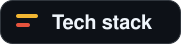
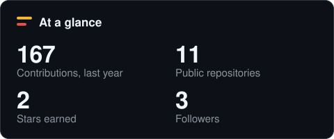
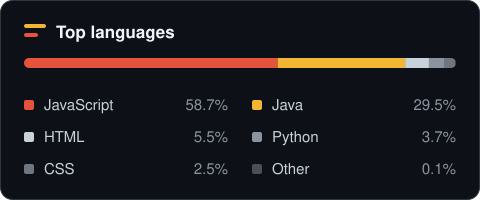
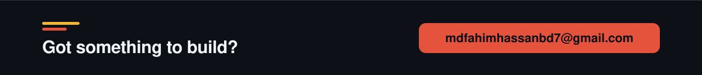

 

## 

- Sophomore **Computer Science & Engineering** student at **BRAC University** (Dhaka, Bangladesh), expected 2029
- I build and deploy complete full-stack apps with **React, Spring Boot, PostgreSQL and Firebase**
- Currently building **Qontrol**, a Kahoot-style live quiz platform, with a teammate

## 

## 

<table>
  <tr>
    <td width="50%" valign="top">
      <h3>FIFA Survivor</h3>
      <a href="https://fifa-survivor-two.vercel.app/"><b>Live demo</b></a> &nbsp;|&nbsp; <a href="https://github.com/MdFahimHassan/FIFA-Survivor">Source</a>
        
      Arcade survival shooter with a ten-stage tournament, scaling enemy waves, an in-run Strategy Room shop and 48 playable nations.
      <ul>
        <li>Top 3 of 7 departments at BUCC Club Fair 2026, built solo in 5 days</li>
        <li>Real-time global leaderboard on Firestore, with scores validated by a Vercel serverless function so fake scores get rejected</li>
        <li>Installable PWA with touch controls and offline handling, played by 200+ people</li>
      </ul>
         
    </td>
    <td width="50%" valign="top">
      <h3>BLNCR</h3>
      <a href="https://blncr-xi.vercel.app/"><b>Live demo</b></a> &nbsp;|&nbsp; <a href="https://github.com/MdFahimHassan/BLNCR">Source</a>
        
      Full-stack group expense splitter that turns messy shared costs into a compact settle-up plan.
      <ul>
        <li>Equal, exact and percentage splits with a greedy debt-simplification algorithm</li>
        <li>Layered Spring Boot REST API with JWT auth, role-based group access and single-use invite links</li>
        <li>Money handled as integer cents with largest-remainder rounding, so splits always sum exactly</li>
        <li>Tested at every level, with CI on GitHub Actions</li>
      </ul>
          
    </td>
  </tr>
  <tr>
    <td width="50%" valign="top">
      <h3>Qontrol (in progress, team of 2)</h3>
      <a href="https://qontrol-virid.vercel.app/"><b>Live demo</b></a> &nbsp;|&nbsp; <a href="https://github.com/MdFahimHassan/Qontrol">Source</a>
        
      Kahoot-style live quiz platform where a host runs a quiz and players join from their phones with a PIN. I built the React frontend: landing page, login and registration, host dashboard and a quiz builder.
      <ul>
        <li>Connected to a Spring Boot REST backend (JWT, quiz CRUD) through an Axios client with token handling and protected routes</li>
      </ul>
         
    </td>
    <td width="50%" valign="top">
      <h3>V.E.C.T.O.R</h3>
      Windows desktop app &nbsp;|&nbsp; <a href="https://github.com/MdFahimHassan/V.E.C.T.O.R">Source</a>
        
      Hands-free voice assistant inspired by J.A.R.V.I.S. Say "Hey Vector" and it uses local Whisper speech recognition plus LLM tool calling (Gemini or Ollama) to set timers, launch apps and control volume.
        
        
        
      Also check out <a href="https://github.com/MdFahimHassan/Corelytics"><b>Corelytics</b></a>, a sleek desktop analytics app with modular design and real-time insights.
    </td>
  </tr>
</table>

## 

- **BRAC University:** B.Sc. in Computer Science and Engineering, expected 2029
- **Coursework:** Data Structures, Discrete Mathematics, Algorithms, Linear Algebra, Probability and Statistics
- **BUCC (BRAC University Computer Club):** General Member, then Executive, then **Senior Executive** (R&D) in 14 months. I run member interview sessions and club fairs.
- **Languages:** English (fluent), Bangla (fluent)

## 

## 

<picture>
  <source media="(prefers-color-scheme: dark)" srcset="https://raw.githubusercontent.com/MdFahimHassan/MdFahimHassan/output/github-snake-dark.svg" />
  <source media="(prefers-color-scheme: light)" srcset="https://raw.githubusercontent.com/MdFahimHassan/MdFahimHassan/output/github-snake.svg" />
  
</picture>

  

